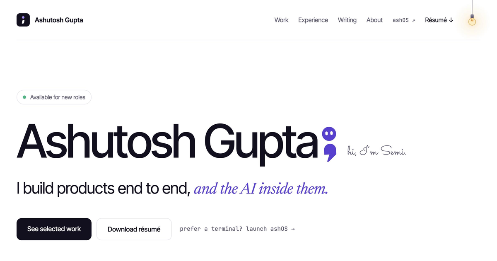

<div align="center">

<picture>
  <source media="(prefers-color-scheme: dark)" srcset="public/brand/logo/wordmark-dark-animated.svg">
  
</picture>

### Full-stack · AI engineer

I build products end to end, *and the AI inside them.*

[](https://iamashutosh.com)
[](https://iamashutosh.com/desktop)
[](https://iamashutosh.com/Ashutosh_Gupta_Resume.pdf)
[](https://www.linkedin.com/in/ashutoshgupta08)
[](https://x.com/im_AshutoshG)
[](mailto:hello@iamashutosh.com)


</div>

<br>

<picture>
  <source media="(prefers-color-scheme: dark)" srcset="public/brand/social/og-dark.png">
  
</picture>

## Hi, I'm Ashutosh;

I'm a full-stack developer who moved into AI engineering. I like software that
feels calm to use and holds up in production, and I don't leave things half
done. Right now I'm a Software Developer at Newel Technologies, building
fintech products for wealth-management firms.

This repository is my portfolio. The quickest way to see it is the live site:
**[iamashutosh.com](https://iamashutosh.com)**.

## Take a look around

The site is one page:

**Selected work** · **Experience** · **Hackathons & wins** · **Kind words** ·
**Toolkit** · **How I work** · **Writing** · **Beyond work**

There are a few small surprises on the way down:

- **Poke the semicolon.** That's Semi, and Semi has a lot to say. The footer
  counts every poke from every visitor.
- **Pull the light bulb** in the top-right corner to switch between light and
  dark.
- **Follow the thin line** in the left margin as you scroll. It's one long
  thought, and it finishes at the bottom of the page.
- **See what's playing.** The hero shows the song I'm listening to right now.

## Prefer a terminal? Try ashOS

**[iamashutosh.com/desktop](https://iamashutosh.com/desktop)** opens the same
portfolio as a small desktop, with Finder, a Terminal, Mail, Safari, a résumé
viewer and settings, all running in your browser.

In the Terminal, try `help`, `about`, `projects`, `neofetch` or `sudo hire-me`.

## Selected work

| Project | What it is | Links |
| --- | --- | --- |
| **GlyphX** | A fast, accessible ⌘K command palette for React, with fuzzy search, light and dark themes, and full TypeScript support. | [Live](https://imashutoshgupta.github.io/glyphx/) · [Code](https://github.com/imAshutoshGupta/glyphx) |
| **Smudge** | A Chrome extension that blurs personal details before you share your screen. | [Live](https://imashutoshgupta.github.io/smudge/) · [Code](https://github.com/imAshutoshGupta/smudge) |
| **RootCause AI** 🏆 | **Winner, Paytm Build for India AI Hackathon** (Mumbai, 2026). An AI teammate that catches UPI payment failures before customers complain, fixes them with human approval, and proves the fix worked. | [Live](https://rootcause-ai-paytm.vercel.app) · [Code](https://github.com/krishna2474/rootcause-ai) |

**Toolkit.** AI engineering: OpenAI, Claude and Gemini APIs, LangChain,
LangGraph, MCP, RAG, embeddings, pgvector, LLM evals. Full-stack: TypeScript,
Python, Next.js, Nest.js, FastAPI, React, PostgreSQL, MongoDB, AWS, Docker.

## Résumé

[Download my résumé (PDF)](https://iamashutosh.com/Ashutosh_Gupta_Resume.pdf),
or [read it here on GitHub](public/Ashutosh_Gupta_Resume.pdf).

## On GitHub

<div align="center">

<picture>
  <source media="(prefers-color-scheme: dark)" srcset="https://github-stats-extended.vercel.app/api?username=imAshutoshGupta&show_icons=true&hide_rank=true&hide_border=true&disable_animations=true&custom_title=GitHub%20activity&bg_color=00000000&title_color=A78BFA&icon_color=A78BFA&text_color=9F9BB3">
  
</picture>
<picture>
  <source media="(prefers-color-scheme: dark)" srcset="https://github-stats-extended.vercel.app/api/top-langs/?username=imAshutoshGupta&layout=compact&langs_count=6&hide_border=true&disable_animations=true&bg_color=00000000&title_color=A78BFA&text_color=9F9BB3">
  
</picture>

<picture>
  <source media="(prefers-color-scheme: dark)" srcset="https://streak-stats.demolab.com?user=imAshutoshGupta&hide_border=true&disable_animations=true&background=00000000&ring=A78BFA&fire=A78BFA&currStreakLabel=A78BFA&sideLabels=EEEDF5&currStreakNum=EEEDF5&sideNums=EEEDF5&dates=9F9BB3&stroke=23212F">
  
</picture>

</div>

## Say hello

I'm open to full-time roles and freelance projects in full-stack and AI
engineering. A rough idea, a half-built prototype or a product that needs AI
done properly are all good places to start.

**[hello@iamashutosh.com](mailto:hello@iamashutosh.com)** ·
[LinkedIn](https://www.linkedin.com/in/ashutoshgupta08) ·
[X](https://x.com/im_AshutoshG) ·
[GitHub](https://github.com/imAshutoshGupta)

<details>
<summary>Run it locally</summary>

<br>

```bash
npm install
npm run dev    # http://localhost:3000
```

Built with Next.js, React, TypeScript, Tailwind CSS, GSAP and Lenis, and
hosted on Cloudflare.

</details>

<br>

<p align="center"><sub>Designed and built, mostly after hours<b>;</b></sub></p>
